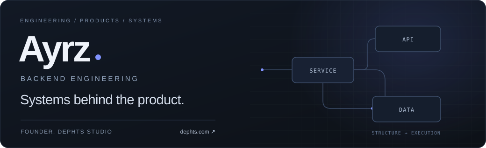
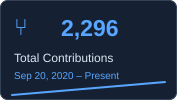
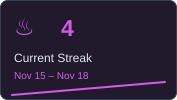
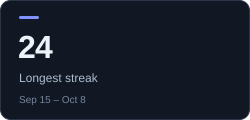

  <a href="https://dephts.com"><strong>Dephts Studio</strong></a>
  &nbsp; / &nbsp;
  <a href="https://github.com/ayrzDev?tab=repositories">Repositories</a>
  &nbsp; / &nbsp;
  <a href="https://github.com/ayrzDev">Connect</a>
  &nbsp; / &nbsp;
  Turkey

I build the systems behind products: APIs, integrations, data flows and the tools that make them work together.

Founder at **[Dephts Studio](https://dephts.com)**. My focus is backend engineering, system design and performance, with a practical approach to shipping and maintaining software.

## Selected work

| Project | Focus |
| :--- | :--- |
| **[Birteg Entegrasyon ↗](https://birteg.com)** E-commerce · Integration platform | Connecting products, stock, pricing and orders across commerce channels. |
| **Grabby** Unity · C# · In development | A 2D climbing adventure, built around movement and exploration. |
| **[Dragon ↗](https://github.com/ayrzDev/Dragon)** PHP · Web framework | A PHP framework for building web applications. |
| **[FlexSQL ↗](https://github.com/ayrzDev/FlexSQL)** PHP · MySQL | A flexible PHP library for working with MySQL. |
| **[Sonar Echo Guard ↗](https://github.com/ayrzDev/SonarEchoGuard)** C# · Windows · Audio | A small tray utility for the Discord and SteelSeries Sonar echo workaround. |

<a href="https://github.com/ayrzDev?tab=repositories">Explore all repositories →</a>

## Working stack

| Area | Technologies |
| :--- | :--- |
| Backend | `PHP` · `Java` · `Python` · `C#` |
| Data | `MySQL` · `MongoDB` · `Redis` |
| Web | `JavaScript` · `TypeScript` · `HTML` · `CSS` |
| Environment | `Docker` · `Linux` |

## Activity

  
  
  

GitHub activity, refreshed automatically.

---

Open to collaborations around backend systems, integrations and useful products. 
**[dephts.com ↗](https://dephts.com)**
