

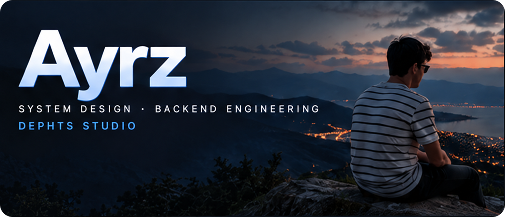

  
  
  

<h3>&nbsp; About Me</h3>

Backend engineer focused on scalable systems, performance and clean architecture.

I build products, solve real problems and turn ideas into working solutions. Always learning, always improving.

  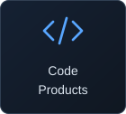
  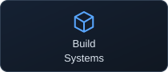
  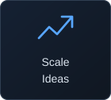
  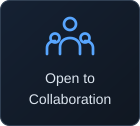

<h3>&nbsp; Tech Stack</h3>

Tools I use every day

<!-- Individual SVG tiles from Devicon (MIT). See assets/DEVICON-LICENSE.txt. -->

  
  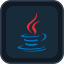
  
  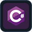
  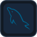
  

  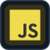
  
  
  
  
  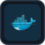
  

<h3>&nbsp; GitHub Stats</h3>

  <a href="https://github.com/ayrzDev?tab=overview">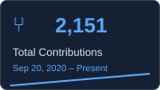</a>
  <a href="https://github.com/ayrzDev?tab=overview">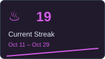</a>
  <a href="https://github.com/ayrzDev?tab=overview">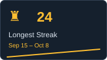</a>

<h3>&nbsp; Featured Projects</h3>

  

  <a href="https://github.com/ayrzDev/Dragon">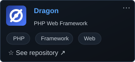</a>
  <a href="https://github.com/ayrzDev/FlexSQL">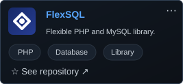</a>

  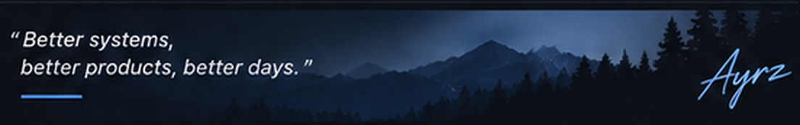

